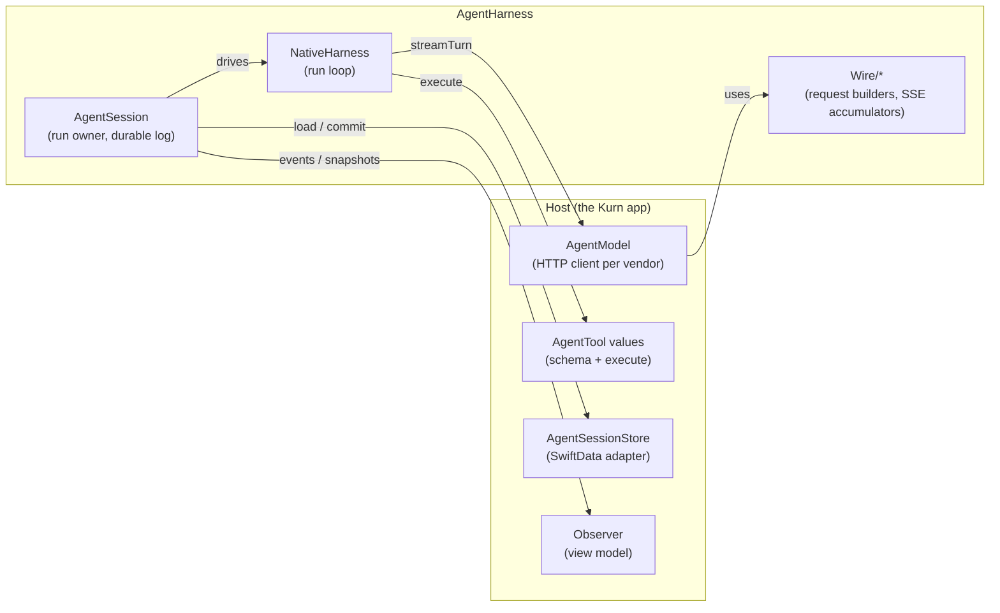
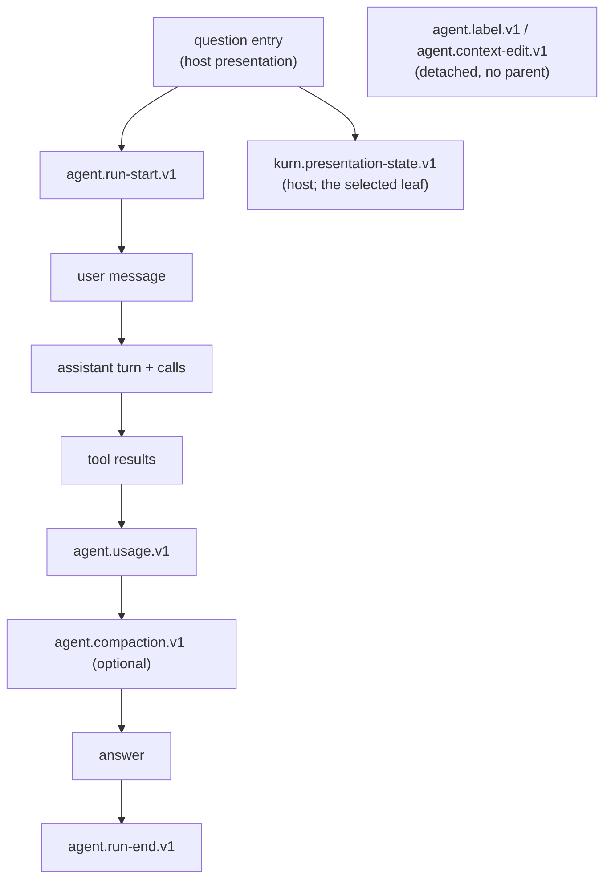

# AgentHarness

A standalone, Foundation-only Swift package that runs an agent: a model that streams turns, calls
tools and answers. It owns the loop, context management, output budgets, retries, usage and cost
accounting, the session log, and the wire formats of four vendor APIs. It has **no dependency** on
the Kurn app, on `KurnCore`, on SwiftData or on any networking stack, and it builds and tests on Linux
(`swift test`).

The app composes it; it never reaches into the app. `Tools/check_static_policy.py` rejects imports that
cross that boundary in either direction. The contract the package implements, item by item, is in
[`docs/contracts/native-harness-v1.md`](../../docs/contracts/native-harness-v1.md), with its
machine-checked catalog; how the app uses it is in [`docs/architecture.md`](../../docs/architecture.md)
and in `CLAUDE.md` ("Agent harness").

## What the host provides, and what it gets back

The host supplies:

| Seam | Protocol / type | Responsibility |
| --- | --- | --- |
| Model | `AgentModel` | Send one `AgentTurnRequest`, report `AgentModelEvent`s as they stream, return an `AgentTurnResponse`. Usually built from `Wire/` request builders and accumulators over the host's transport. `AgentPerRequestModel` rebuilds the client for every request, so credentials are resolved per request. |
| Tools | `AgentTool`, `AgentToolSchema`, `AgentToolPolicy` | JSON schema, argument validation, optional confirmation policy, execution through `AgentToolExecutionContext`. Tool failures become error results, not thrown errors. |
| Store | `AgentSessionStore` | `load(sessionID:)` and an atomic, revision-checked `commit(_:)` of an append group. A conflict throws `AgentSessionStoreError.conflict`. |
| Errors | `AgentTransientError`, `AgentContextOverflowError` | Classify the host's own errors as retryable or as a context overflow. |
| Policy | `AgentLimits`, `AgentContextPolicy`, `AgentRetryPolicy`, `AgentCompactionPrompts`, a cost estimator | Turn/tool/cost ceilings, the model's window and reserve, retry backoff, summary prompts, pricing. |

It gets back `AgentEvent`s (or `AgentRunSnapshot`s, coalesced), a final `AgentRunOutcome`, and a
durable, append-only session log.

## Source layout

| Directory | Contents |
| --- | --- |
| `Sources/AgentHarness/` (root) | Messages and blocks (`AgentContentMessage`, `AgentToolResultMessage`, `AgentMessage`), the loop (`NativeHarness` and its `+ModelTurn`, `+Tools`, `+ContextWindow` extensions), `AgentTypes` (requests, responses, events, limits, outcomes), stream reduction (`AgentTurnStream`, `AgentMessageReducer`), budgets (`AgentOutputBudget`, `AgentBudgetPlanner`, `AgentRunState`), context (`AgentContextCompactor`, `AgentContextResolution`, `AgentContextOverflow`, `TokenEstimate`), retries (`AgentRetryPolicy`), traces and diagnostics (`AgentRunTrace`, `AgentDiagnostic`), paging (`AgentTextPage`) and `JSONValue`. |
| `Models/` | Model capacity: the reviewed `ModelContextCatalog` and the `ModelContextWindows` resolver. |
| `Tools/` | Tool schemas and argument validation, the execution pipeline, execution context. |
| `Session/` | Run ownership and the durable log: `AgentSession`, entries and the entry graph, run branches, compaction checkpoints, context edits, system prompts and tool loadouts, input queues, progress and snapshots, the session tree, the archive, recovery records. |
| `Wire/` | Request builders and SSE accumulators for Anthropic Messages, OpenAI Responses, OpenAI Chat Completions and Gemini, plus the replay projection that copies canonical messages into a vendor request. |

## The run loop (`NativeHarness`)

A sequential tool loop: request → stream → tools → request, until the model answers, a limit stops
it, or it fails.

1. **Context.** Before each request the context size is the provider's last reported usage plus
   estimates of the messages appended since (`TokenEstimate`, script-aware). Over the threshold
   (window minus reserve, never below half the window) the conversation is compacted first.
2. **Output budget.** `AgentOutputBudget` caps every request's output to the room the window leaves
   (pi's `clampMaxTokensToContext` policy), with an explicit 4,096-token fallback for unknown models.
3. **Request.** `AgentModel.streamTurn` streams `AgentModelEvent`s. `AgentTurnStream` and
   `AgentMessageReducer` order blocks, apply the final replacement and fence late content. A
   stream without a terminal event is not used.
4. **Tools.** Every call of a turn is registered with its own invocation identity, validated,
   optionally confirmed, executed and answered with a result message, before the next request.
5. **Stop.** A reply with no tool call ends the run. Turn, tool-call and cost limits end it with an
   explicit `AgentRunStopReason`; `wrapUpOnLimit` first asks for one tool-less answer.

Recovery inside a run:

- **Overflow.** A request rejected as too long forces a compaction and is retried once, only if
  nothing was streamed and the context shrank.
- **Empty, cut-off reply.** One retry after a forced compaction, under the same conditions.
- **Transient failure.** `AgentRetryPolicy` sends the request again as a new request after a
  cancellable backoff, waiting the provider's Retry-After when the error carries one
  (`AgentTransientError.retryAfterSeconds`, or an `AgentRetryAfter` wrapper the harness unwraps). It is never retried after visible text.
- **Output limit.** Hitting the output limit ends with `.outputLimit` and discards that turn's calls.

Modifiers install the host's barriers. Each awaited sink must succeed before dependent work
continues:

| Modifier | Committed before |
| --- | --- |
| `persistingMessages(_:)` | Model IO (user messages), tool effects (assistant finals), the next request (results) |
| `persistingUsage(_:)` | Each request's usage is recorded |
| `persistingCompaction(_:)` | Any request uses compacted context |
| `receivingInput(_:)` | (Not a barrier.) Injects queued steering after each tool batch and follow-ups when it would finish |

`start(...)` returns an `AgentRunHandle` (events plus `result()`); `run(...)` is the legacy stream form;
`continueRun(...)` answers an open request or one queued input without a new prompt.

## Context management

`AgentContextCompactor` follows pi-coding-agent's design (no code copied).

- **What is kept.** `plan` keeps the newest `keepRecentTokens` and cuts at a user or assistant
  message, never at a tool result. A cut inside the current turn gives the turn's earlier part its own
  prefix summary.
- **The summary request.** It is tool-less, sends the conversation as labelled text, and uses
  injectable prompts (`AgentCompactionPrompts`). A later compaction updates the previous summary.
- **When it fails.** A summary that is cut off or unusable changes nothing and is reported as failed.
  No note ever stands in for a summary.
- **Durability.** A successful summary is an `AgentCompactionCheckpoint`, committed before use, so a
  reopened conversation reuses it.

## Sessions and the durable log

`AgentSession` owns one run at a time against a store:

- **Busy before IO.** It reserves busy state before any await, writes `agent.run-start.v1` before any
  model IO, and commits every message and usage entry through the harness sinks.
- **Settling.** It ends with `agent.run-end.v1`, and releases ownership only after the producer and
  the terminal write have settled.
- **Conflicts.** Each append is rebuilt on the snapshot it commits on, retried on a conflict up to
  four times.
- **Idempotent commands.** `start(commandID:)` makes a command idempotent across processes: a
  command already in the log writes nothing and calls no model.
- **Branch mode.** `.branch` chains a run's entries from the leaf at run start without moving the
  selected leaf, so runs live beside the conversation.

| Type | Role |
| --- | --- |
| `AgentSessionEntry`, `AgentEntryGraph` | Checked entry (`contractVersion` 1, session ID, ID, parent, ordinal, UTC time, payload, metadata) and validation of the whole append log |
| `AgentRunBranch` | One run read back from the log: start fields, end, the messages it added to context, its answer |
| `AgentSystemPrompt`, `AgentSystemPatch`, `AgentToolLoadout` | The system prompt as ordered sections, recorded in full for the first run and as a patch afterwards, with each run's declared tools |
| `AgentCompactionCheckpoint`, `AgentContextEdit` | Durable summaries, and edits that change only what later runs replay |
| `AgentInputQueue` | Steering and follow-up FIFO queues, saved before acknowledgement |
| `AgentRunProgress`, `AgentRunSnapshot(s)`, `AgentRunTrace` | Presentation projections of a run's events (phase, streamed text, steps, usage), never part of persistence ordering |
| `AgentSessionTree` | Alternatives at a message, navigation that only moves the leaf, fork/clone copies, detached labels, usage per branch or per session |
| `AgentSessionArchive`, `AgentJSONLLines` | Native versioned JSON Lines interchange (`kurn.agent-session` v1), LF-only framing, limits and graph validation |
| `AgentRecoveryRecord` | Host recovery metadata (`run`, `queue`, `draft`, `effect`); data only, never a scheduler |

Entry types written by the package:

| Type | Written by | Meaning |
| --- | --- | --- |
| `message` (payload) | `AgentSession` | A native user, assistant or tool-result message |
| `agent.run-start.v1` | `AgentSession` | Run ID, host start fields, command ID, system prompt or patch, tool loadout |
| `agent.usage.v1` | `AgentSession` | One request's reported usage, including reasoning and cache counters |
| `agent.compaction.v1` | `AgentSession` | A summary checkpoint: summary, first kept message, tokens before and after |
| `agent.run-end.v1` | `AgentSession` | How the run ended and the harness stop reason |
| `agent.context-edit.v1` | Host (via the store) | Messages later runs leave out of replay |
| `agent.label.v1` | `AgentSessionTree.labelEntry` | A label on an entry (detached metadata) |

Host entry types (for example the app's `kurn.presentation-state.v1`) are opaque to the package.

## Wire formats

`AgentWireFormat` builds requests and accumulates SSE payloads for each API:

- Anthropic Messages.
- OpenAI Responses, with `store: false` on the official endpoint.
- OpenAI Chat Completions, for compatible servers.
- Gemini GenerateContent.

`AgentReplayProjection` copies canonical messages into a vendor request, keeping call identities and
the opaque replay metadata (Gemini thought signatures, response IDs), and dropping what another vendor
cannot accept only in the copy. A turn that disallows tools sends `tool_choice: none` (Gemini: mode
`NONE`), and calls returned anyway are dropped.

## Diagnostics and privacy

`AgentDiagnostic` carries only a fixed event and metric vocabulary, counts and opaque correlation IDs
(session, run, request, invocation). Prompts, excerpts, tool arguments, document bodies, credentials
and raw error text never enter a diagnostic.

## Invariants worth keeping

- Foundation only: no SwiftData, SwiftUI, Kurn or KurnCore types, and no transport.
- **Ordering:** a canonical write precedes the work that depends on it; a failed write fails the run.
- **History:** entries are never rewritten; a branch is new entries under an older one.
- **Retries:** after visible text there is no automatic retry; previously committed tools never run
  again during recovery.
- **Unknown values:** unknown usage, cost or capacity stays unknown (nil or an explicit fallback),
  never zero or invented.
- **Versions:** contract, fixture, archive and the host's storage versions are distinct and evolve
  independently.

## Tests

`Tests/AgentHarnessTests/` has one suite per component, frozen synthetic fixtures under `Fixtures/`
whose hashes the contract catalog pins, and scripted models and stores in place of vendors. Run with
`cd Packages/AgentHarness && swift test`. CI runs it on Linux and exports coverage (`agentharness` flag).
