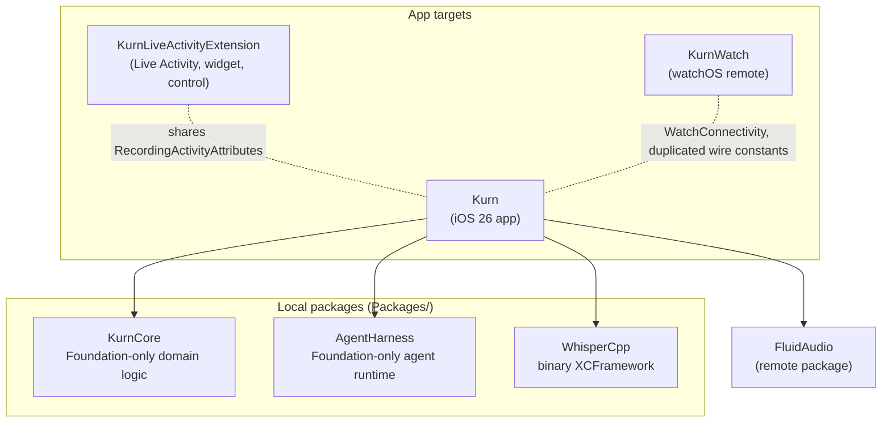
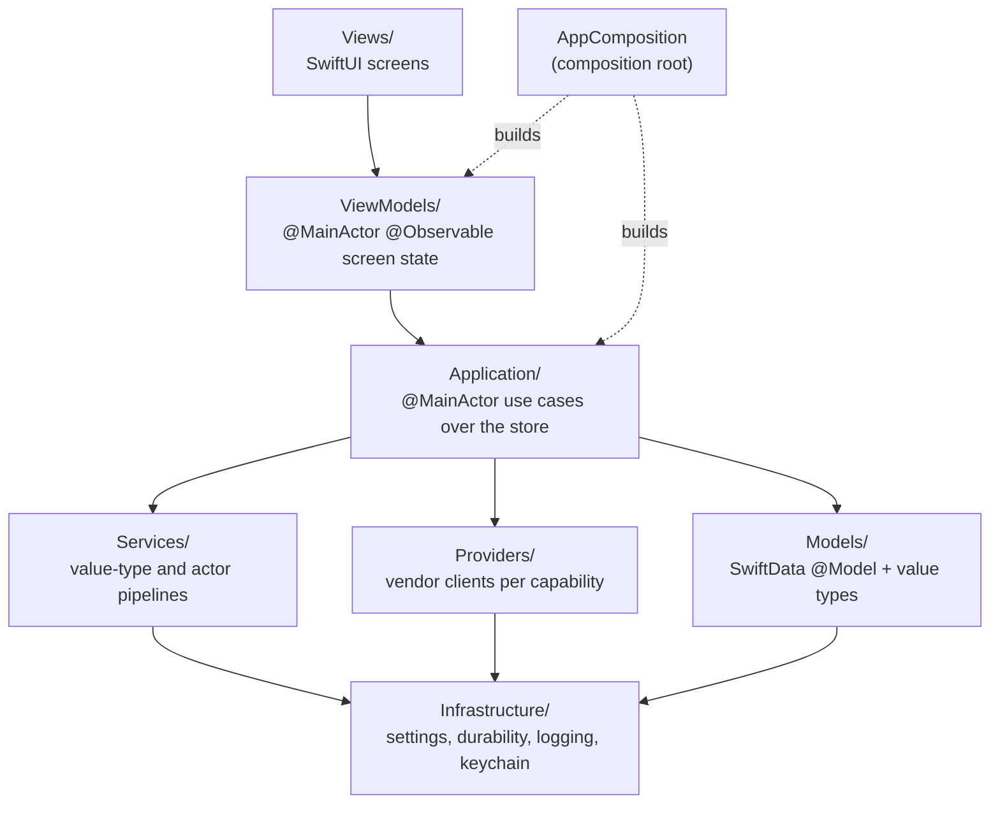
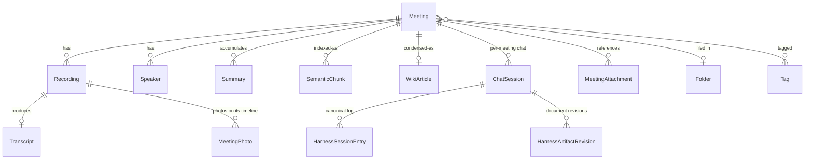
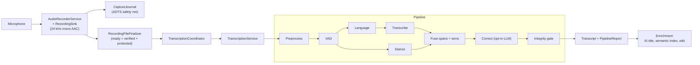
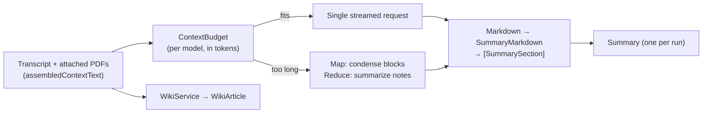
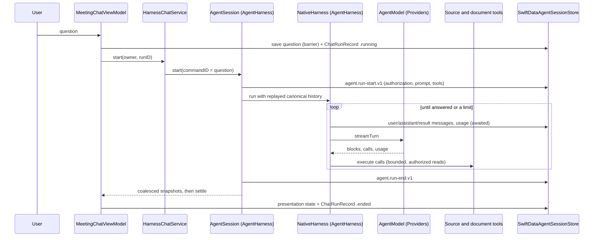

# Kurn architecture

This is the map of how Kurn is built: its modules, how they depend on each other, and the paths
data takes from microphone to transcript, summary and chat. It stays at the level of modules and
flows. The detailed contracts, including invariants, edge cases and the reasons behind them, live in
[`CLAUDE.md`](../CLAUDE.md), and each section below says which part of it to read. The agent
harness has its own module guide: [`Packages/AgentHarness/README.md`](../Packages/AgentHarness/README.md).

## Principles

- **Local first.** Recordings, transcripts, summaries, the search index and chat history live on the
  device, in one encrypted SwiftData store and in protected files. A fresh install transcribes
  offline. Nothing reaches the network until the user picks a cloud provider or approves a model
  download.
- **Directional dependencies.** Lower layers never name a type from a higher one, and a static
  policy check enforces it.
- **Durable before visible.** Success is reported only after the authoritative state is saved. A
  fallback is recorded and shown, never silent.
- **Seams over special cases.** Every pipeline stage, provider capability and framework adapter
  sits behind a protocol, so engines can be swapped and logic is tested without hardware, models
  or the network.

## Modules

| Module | Role | Built and tested |
| --- | --- | --- |
| `Kurn` | The iOS app: capture, pipeline, providers, SwiftData, UI | Xcode, `KurnTests`, `KurnSwiftDataTests`, `KurnUITests` |
| `KurnCore` | Pure Foundation logic: errors, reliability events, transcript pipeline value types, export documents, chat domain types, policies | `swift test` on Linux |
| `AgentHarness` | The agent loop, context management, sessions and vendor wire formats ([module guide](../Packages/AgentHarness/README.md)) | `swift test` on Linux |
| `WhisperCpp` | A `.binaryTarget` pointing at whisper.cpp's official XCFramework | Linked by the app only |
| `KurnWatch` | Watch remote for pause/resume/stop, sharing no source with the app | Xcode |
| `KurnLiveActivityExtension` | Lock Screen Live Activity, Control Center control, start-recording widget | Xcode |

`KurnCore` and `AgentHarness` are independent: neither imports the other. The app composes both.

## Layers of the app target

| Layer | Contents |
| --- | --- |
| **Models** | `@Model` classes (`Meeting` is the aggregate root) and shared value types. |
| **Services** | Capture, the transcription pipeline, on-device engines, summaries, wiki, search. Mostly `Sendable` structs and actors working on plain values, safe off the main actor. |
| **Providers** | One protocol per capability: `LLMProvider`, `TranscriptionProvider` and `SpeechSynthesisProvider`, backed by shared HTTP policy, URL validation and transport. |
| **Application** | Every library mutation goes through `MeetingLibrary`; every transcription run through `TranscriptionCoordinator`. The agent chat composition lives in `Application/Agent`. |
| **ViewModels** | State for one kind of screen. |
| **Views** | Render that state. They never insert into or delete from a `ModelContext` and never touch the Keychain. |

Dependencies point down. `Tools/check_static_policy.py` rejects:

- an upward dependency;
- a store mutation inside a view;
- Keychain access from a view;
- an import that crosses the `KurnCore`/`AgentHarness` boundary;
- an unredacted log of error text.

`AppComposition` builds every store-dependent coordinator once per container. The scene and the
background-task runner both get them from there.

See `CLAUDE.md`, "Architecture", for the full layer descriptions.

## Data model

Deleting a meeting cascades to every artifact derived from its transcript. That cascade is what
makes "delete the meeting" a complete erasure.

- **Generated documents** are the deliberate exception: they snapshot their sources instead of
  relating to them.
- **Library chat sessions** have no meeting, so no cascade reaches them; "Delete all data" removes
  them explicitly.
- **Collections stored as JSON.** Arrays SwiftData cannot store (such as transcript segments) are
  JSON `Data` behind computed properties.
- **Schema changes.** The schema is versioned (`KurnSchema`) with frozen copies of earlier versions.

See `CLAUDE.md`, "Data model" and "Semantic search & chat".

## Flow 1: recording to transcript

- **Every stage is a protocol.** The engine per stage is chosen in settings.
- **The defaults need no download,** except neural diarization, which falls back to the heuristic
  diarizer until the user consents.
- **Long runs are chunked** and checkpointed after every chunk. They survive backgrounding and
  termination, with a background processing task and recovery sweeps at launch.
- **Each transcript records its pipeline report:** what each stage was asked for, what ran, and
  whether it degraded.

See `CLAUDE.md`: "Audio storage format", "Transcription pipeline", "Resumable transcription",
"Choosing the diarizer", "Speaker identity".

## Flow 2: summaries, wiki and documents

- **Templates** shape each summary. A meeting accumulates summaries rather than holding one.
- **The wiki** reuses the summary service's notes stage.
- **Documents** are artifacts the chat agent writes (flow 3) and the user saves into the library.

See `CLAUDE.md`: "Providers", "Derived artifacts: wiki and documents", "Export formats".

## Flow 3: chat through the agent harness

The app's side of the harness:

- **Composition.** `HarnessChatService` resolves the model's context window and composes the
  harness with Kurn's tools, prompts and pricing.
- **Tools.** `ChatSourceTools` and `ChatDocumentTools` read only the sources the run's frozen
  authorization allows. Results are compact plain text.
- **Store.** `SwiftDataAgentSessionStore` is the store adapter. Each run is a branch off the question
  it answers, and it never moves the selected leaf. The presentation state shown in the UI is its
  own entry.
- **Ownership.** `ChatConversationHost` keeps one conversation per scope alive, so a reply survives
  dismissing its screen.
- **Recovery.** Launch recovery closes runs a dead process left open. An interrupted run is resumed
  at most once.
- **Replay.** The next question replays earlier runs canonically, but only those authorized for
  sources the current run may read.
- **Tree and archive.** Conversations branch, navigate, fork and clone (`AgentSessionTree`), and they
  export and import as native archives (`AgentSessionArchive`).

See the [harness module guide](../Packages/AgentHarness/README.md) for the runtime, and `CLAUDE.md`,
"Agent harness" and "Awaited runtime persistence and initial session owner", for the app integration.
The specification the harness is held to is [`docs/contracts/native-harness-v1.md`](contracts/native-harness-v1.md).

## Security and privacy

- **Files at rest.** Recordings, photos and attachments live in `Documents/Recordings/` with
  `completeUnlessOpen` protection.
- **The store.** The SwiftData store has the same protection. No meeting-derived text or vectors
  ever go to a loose file or `UserDefaults`.
- **The lock.** It is a window above the whole scene (`SecurityCoverWindow`), not a view branch, so
  no sheet is destroyed or exposed. Actions that weaken protection or redirect content
  re-authenticate (`SensitiveActionAuthorizer`).
- **Secrets.** API keys live only in the Keychain. Provider destinations are HTTPS-validated and
  fail closed.
- **Leaving the sandbox.** Content copies only through an expiring local pasteboard. Model Markdown
  renders with links disabled. Downloaded models are pinned by SHA-256.
- **Diagnostics.** Reliability events, harness diagnostics and crash reports carry fixed codes and
  counts, never content.

See `CLAUDE.md`, "Secure local storage for recordings", and [`SECURITY_MODEL.md`](../SECURITY_MODEL.md).

## Durability and recovery

The `Infrastructure/` durability layer turns six invariants (H-I1 to H-I6) into tested contracts:

| Concern | Mechanism |
| --- | --- |
| Store boot | A boot state machine that never silently opens elsewhere |
| Backup | Protected backup, restore and salvage |
| Deletes | Move-then-purge into a trash folder, with an operation journal |
| Bad data | Quarantine instead of deletion |
| Persisted JSON | Versioned envelopes |
| Concurrency | One resource scheduler for heavy work |
| Reliability log | A bounded, redacted, encrypted event log |

Every new state transition lands with a fault-injection test.

See `CLAUDE.md`, "Durability & recovery".

## Testing and CI

| Suite | Scope |
| --- | --- |
| `KurnTests` | App logic, with seams injected as constructor defaults |
| `KurnSwiftDataTests` | Store boot, salvage and concurrency, process-isolated |
| `KurnUITests` | The accessibility audit and user flows |
| Package tests | `swift test` on Linux |

GitHub Actions runs:

- lint, localization and store metadata checks;
- the static policy and the harness contract checker;
- simulator unit and UI tests;
- the Linux package suites;
- a coverage gate (80% on changed in-scope lines, plus per-layer floors).

Accuracy is measured separately on public datasets, recorded in `docs/pipeline-evaluation.md`.

See `CLAUDE.md`: "Commands", "Verifying without a local macOS/Xcode toolchain", "Measuring accuracy".

## Where to go next

| Question | Document |
| --- | --- |
| What does the app do? | [`README.md`](../README.md) |
| Conventions, invariants and the reasons behind them | [`CLAUDE.md`](../CLAUDE.md) |
| How the agent runtime works | [`Packages/AgentHarness/README.md`](../Packages/AgentHarness/README.md) |
| What the harness must satisfy, and what is verified | [`docs/contracts/native-harness-v1.md`](contracts/native-harness-v1.md) |
| What is still open | [`docs/roadmap.md`](roadmap.md) |
| Threat model | [`SECURITY_MODEL.md`](../SECURITY_MODEL.md) |
